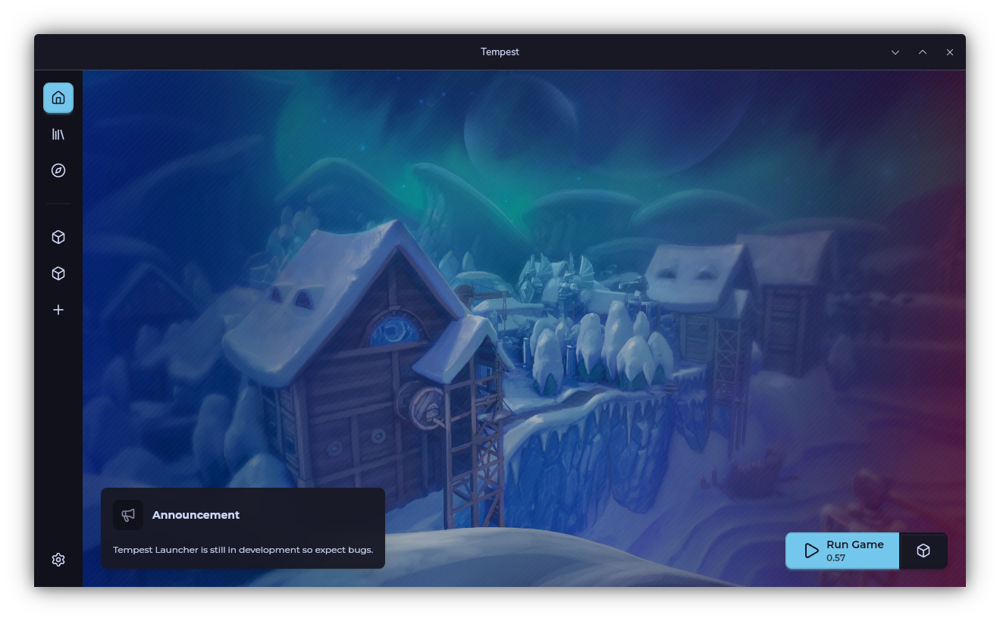

# Tempest

Tempest is a community-made launcher for paladins.
Capable of:

- Downloading and playing any patch of paladins released from 2016 to 2026
- Playing with mods
- Hosting and Joining private servers

Learn more about Tempest and Paladins on our [wiki](https://docs.lowrezstudio.com/).

## Launcher

### Crash reports

After a crash, the launcher offers to send logs or save a copy. You can optionally
enter your Discord username so the Tempest team can follow up. It is included in
the Discord post and the saved report; leaving it blank does not prevent reporting.
Nothing is sent until you click **Report logs**.

## Contributing

If you want to contribute to the project, start by reading the [contributing guide](.github/CONTRIBUTING.md). If you have any questions, feel free to ask in our [Discord server](https://discord.gg/2FyZDuxAk4d9).

### Mod installation and toggles

Installing a mod without deltas does not scan unrelated delta-managed game files.
Replacing a delta mod, or replacing a whole file used as a delta's base, still
reconciles the affected targets. Shared `.tobj` files are payloads referenced by
`.tdelta` files, not independent changes to game files.

Enable/disable reconciles only the affected targets and commits the enabled state
after the files are ready. Failed changes restore the previous files and metadata;
locked files, missing snapshots, and failed delta builds are errors, not successful
toggles. Signed mods are reverified when enabled so Lua can reload without another
game launch. The launcher keeps rows busy until their confirmed state is refreshed,
with Installing, Enabling, Disabling or Removing labels matching the operation.
DLLs and game assets already loaded by a running game still require a restart for
their enabled/disabled state to take effect.

Pressing Play while mods are downloading, queued, installing, enabling, disabling
or being removed schedules one launch for that instance. It shows **Waiting for
mods...**; click again to cancel the launch without stopping the mod work. The game
starts only when all pending mod work for its game folder has succeeded, including
work added while waiting. A failed or cancelled operation cancels the scheduled
launch; press Play again after resolving it. Unrelated game folders do not block it.
